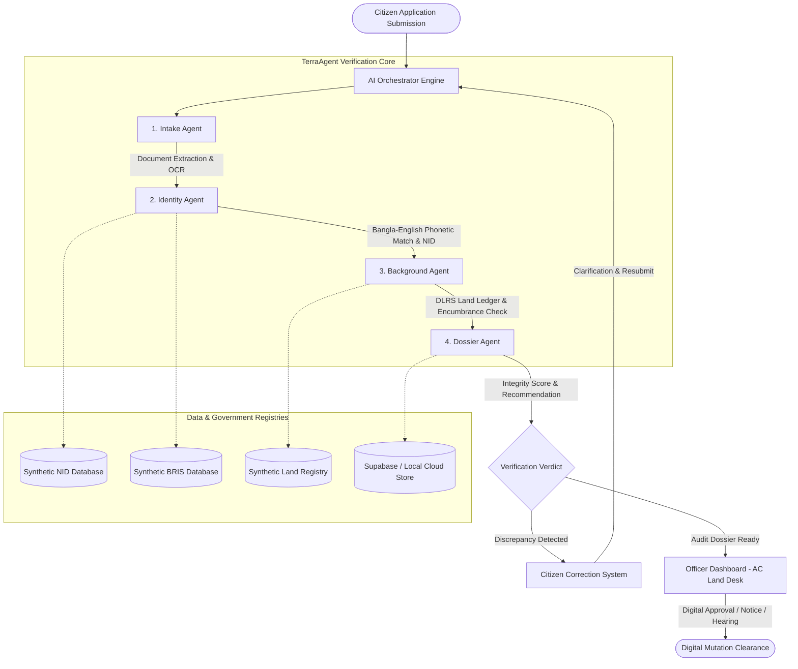

# TerraAgent 🌍
> **Autonomous Multi-Agent Public Service & Land Mutation (e-Namjari) Verification Platform**  
> *Developed for AI Builders Fest • Scalable for Bangladesh Public Administration Modernization*

[](https://vercel.com)
[](https://react.dev)
[](https://supabase.com)
[](https://openai.com)

---

## 📌 Executive Summary

In Bangladesh, public administration services—particularly **Land Mutation (ই-নামজারি)**, **Record of Rights verification (খতিয়ান/পর্চা)**, and **Citizen Identity authentication**—suffer from severe operational bottlenecks:
1. **Linguistic & Transliteration Discrepancies**: Spelling variance between Bengali script (`মো: আশরাফুল আল সাবিদ`) and English transliterations (`Md. Ashraful Al Sabid` vs `Mohammad Ashraful Al-Sabit`) triggers lengthy bureaucratic delays or wrongful rejections.
2. **Disconnected Registries**: Manual cross-checking between the National ID (EC), Birth Registration (BRIS), and Directorate of Land Records & Surveys (DLRS) consumes weeks for Upazila Land Officers (AC Land) and Kanungos.
3. **Encumbrance & Fraud Risks**: Undetected court injunctions (মোকদ্দমা/নিষেধাজ্ঞা), tax arrears (ভূমি উন্নয়ন কর), and prohibited mutations of State Vested Property (অর্পিত সম্পত্তি).

**TerraAgent** resolves these challenges with a pipeline of **4 specialized autonomous AI agents** coordinated by a central orchestrator.

---

## 🏛️ System Architecture



---

## 🤖 The Four Specialized Agents

| Agent | Icon | Primary Responsibility | Key Output |
| :--- | :--- | :--- | :--- |
| **Intake Agent** | 📄 | Scans uploaded files (Smart NID scans, Khatian Porcha, Registered Deeds). Validates document checklist and runs OCR confidence scoring. | Extracted metadata JSON & completeness checklist |
| **Identity Agent** | 🪪 | Executes bilingual phonetic & orthographic comparison (Levenshtein + token overlap) between Bengali and English names. Cross-references synthetic NID & BRIS. | Name similarity percentage, discrepancy flags, identity rating |
| **Background Agent**| 🏛️ | Interrogates Land Records (Khatian, Plot, Mouza, JL Number). Checks for Court Injunctions, Vested Property ("ক" তফসিল), and unpaid Land Development Tax (Dakhila). | Encumbrance status, litigation warnings, tax arrears record |
| **Dossier Agent** | 📋 | Aggregates all agent streams into a unified executive Dossier Report. Calculates composite Integrity Score (0-100) and formulates recommendations. | Official verification report with AC Land decision checklist |

---

## 🚀 Key Features

1. **Citizen Portal**:
   - Complete application form for applicant identity and land parcel schedules.
   - Quick-load test personas for instant hackathon evaluation.
   - Interactive document uploader with simulated OCR inspection.
2. **Real-time AI Orchestrator Console**:
   - Live multi-stage progress tracking across all 4 agents.
   - Interactive terminal showing streaming agent thought process and audit logs.
3. **Citizen Correction System**:
   - Automatically highlights detected discrepancies (e.g., spelling mismatch or missing tax clearance).
   - 1-click **"Autofill Official"** helper to sync with official NID records.
   - Live resubmission loop that re-runs the multi-agent pipeline instantly.
4. **Officer Inspection Dashboard (AC Land Desk)**:
   - Caseload metrics (Total, Verified, Discrepant, High Risk).
   - Search and filter applications by status and risk level.
   - Deep inspection drawer with official decision actions:
     - **Approve Mutation (অনুমোদন)**
     - **Request Clarification (নোটিশ)**
     - **Summon Hearing (শুনানি)**
     - **Reject Application (বাতিল)**
5. **Printable / Exportable Digital Dossier**:
   - Formal Government of Bangladesh Ministry of Land formatted certificate with QR/Hash metadata.

---

## 🛠️ Technology Stack

- **Frontend**: React 18, Vite, Tailwind CSS, Lucide Icons
- **Backend**: Node.js, Vercel Serverless Functions (`/api/orchestrate.js`, `/api/records.js`)
- **Database**: Supabase PostgreSQL with Row Level Security (RLS) + Resilient LocalStorage fallback
- **AI / LLM**: OpenAI GPT-4o-mini integration with deterministic heuristic simulation fallback

---

## ⚙️ Getting Started

### Prerequisites
- Node.js 18+ or 22+
- npm or pnpm

### Installation

```bash
# Clone the repository
git clone https://github.com/Ashraful-Al-Sabid/TerraAgent.git
cd TerraAgent

# Install dependencies
npm install

# Configure environment variables (optional for local demo)
cp .env.example .env.local

# Start development server
npm run dev
```

Visit `http://localhost:3000` to interact with TerraAgent.

### Testing Preset Scenarios
Use the 1-click persona chips at the top of the Citizen Portal:
- **Persona 1 (Clean Mutation)**: Demonstrates fast-track 96% high-integrity approval.
- **Persona 2 (Spelling Mismatch)**: Triggers Identity Agent discrepancy flag & citizen correction workflow.
- **Persona 3 (Disputed Land / Injunction)**: Flags civil litigation stay order in Gazipur Sadar.
- **Persona 4 (Vested / Khas Property)**: Detects prohibited government land in Mirpur and recommends rejection.

---

## 🔒 Security & Privacy

- **Synthetic Records Only**: No real citizen PII is stored or exposed.
- **Secure Key Storage**: API keys are accessed through environment variables or secure local browser storage.
- **Audit Trails**: Every agent decision and officer review is immutably logged with timestamp and event details.

---

## 📄 License
MIT License. Built for the **AI Builders Fest 2026**.
